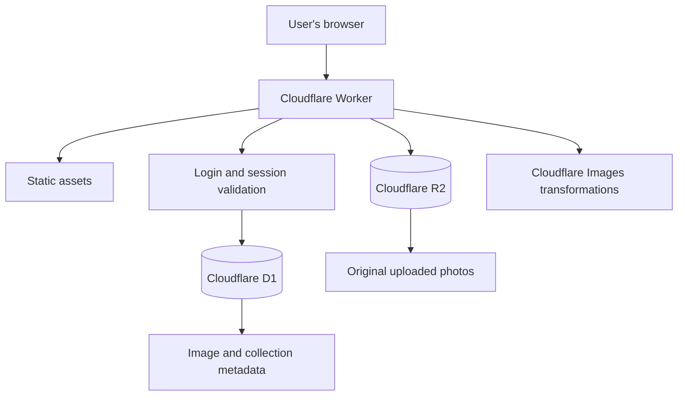

# Cloudflare Shared Gallery: Setup, Deployment and GitHub Documentation

**Project:** Cloudflare Shared Gallery  
**Source project:** https://github.com/Zesty0wl/cloudflare-shared-gallery  
**My GitHub repository:** https://github.com/hanumanth572/cloudflare-shared-gallery  
**Live application:** https://shared-gallery.hanumanthrao572.workers.dev  
**Local project folder:** `~/projects/cloudflare-shared-gallery`

---

## 1. Project overview

I deployed the Shared Gallery application using Cloudflare services. The application provides a shared photo gallery with login protection, image uploads, collections, and recently deleted images.

The project uses:

- **Cloudflare Workers** to run the application.
- **Cloudflare R2** to store original uploaded images.
- **Cloudflare D1** to store gallery data and metadata.
- **Cloudflare Images** for image transformations.
- **Vite and React** for the application build.
- **Wrangler** to configure and deploy the application.
- **Git and GitHub** for version control and source-code hosting.

### High-level architecture



The D1 database stores information about images and collections. R2 stores the original image files. The Worker handles application requests and checks authentication for protected API and media routes.

---

## 2. Local development environment

I used Windows with VS Code and WSL2 Ubuntu for development.

| Component | Environment / version |
|---|---|
| Operating system | Ubuntu 26.04.1 LTS on WSL2 |
| Node.js | v24.22.2 |
| npm | 11.19.1 |
| Git | 2.53.0 |
| OpenSSL | 3.5.5 |
| Wrangler | 4.107.1 |
| Project directory | `~/projects/cloudflare-shared-gallery` |

### Open the project

```bash
mkdir -p ~/projects
cd ~/projects
git clone https://github.com/Zesty0wl/cloudflare-shared-gallery.git
cd cloudflare-shared-gallery
```

Install the project dependencies:

```bash
npm ci
```

Check the installed tools:

```bash
node --version
npm --version
git --version
npx wrangler --version
```

### Install dependencies and run the local checks

```bash
npm run build
```

The first TypeScript check reported missing Worker binding types. I generated the Cloudflare Worker types:

```bash
npm run cf-typegen
```

The generated `worker-configuration.d.ts` file is local/generated and is ignored by Git.

The Worker TypeScript check also needed the application secret types. I created `env.d.ts` in the project root:

```typescript
interface Env {
  JWT_SECRET: string;
  GALLERY_PASSWORD_HASH: string;
}
```

I added `env.d.ts` to the `include` list in `tsconfig.worker.json`:

```json
"include": [
  "src/worker",
  "src/shared",
  "worker-configuration.d.ts",
  "env.d.ts"
]
```

Then I ran:

```bash
npm run check
npm run build
```

Both checks completed successfully.

---

## 3. Local development secrets

The application uses two secrets:

- `JWT_SECRET` is used to sign gallery login sessions.
- `GALLERY_PASSWORD_HASH` stores a password hash rather than the plain-text gallery password.

The local development secrets are stored in `.dev.vars`. This file is excluded from Git by `.gitignore`.

The example file `.dev.vars.example` contains placeholders. I created a separate local `.dev.vars` file and set restrictive file permissions. I did not commit this file.

The password hash is generated by the project's script:

```bash
node scripts/hash-password.mjs
```

The script expects the password as an argument, so do not put a real password directly into shell history. For local setup, I entered the password through a hidden prompt and used the script to generate the hash.

A local credential file should never be copied into the repository or shared in screenshots, terminal logs, or chat messages.

### Verify that the local secrets file is ignored

```bash
git check-ignore .dev.vars
```

Expected output:

```text
.dev.vars
```

---

## 4. Local application testing

I started the local application with:

```bash
npm run dev
```

Vite displayed the local development URL in the terminal. I opened that URL in the browser and tested the application locally.

The local tests included:

1. Opening the gallery login page.
2. Logging in with the local development password.
3. Uploading a sample image.
4. Opening and viewing the image.
5. Creating a collection.
6. Adding the sample image to the collection.
7. Deleting the image.
8. Opening Recently Deleted.
9. Restoring the image.

These tests were performed against the local development environment, before the production deployment.

---

## 5. Connect my Cloudflare account

I signed in to my own Cloudflare account through Wrangler:

```bash
npx wrangler login
```

I verified the account connection:

```bash
npx wrangler whoami
```

This authorizes Wrangler to manage the Cloudflare resources in my account. The Wrangler authentication token is stored locally by Wrangler and must not be committed or shared.

---

## 6. Create Cloudflare resources

I created my own D1 database and R2 bucket for this deployment.

### 6.1 Create the D1 database

```bash
npx wrangler d1 create shared-gallery-db
```

The database created in my Cloudflare account:

| Setting | Value |
|---|---|
| Database name | `shared-gallery-db` |
| Database ID | `ec5b165b-06fb-416a-8536-79fedcda56aa` |
| Region | APAC |

I checked the database information:

```bash
npx wrangler d1 info shared-gallery-db
```

### 6.2 Create the R2 bucket

R2 stores the original uploaded photos. D1 stores the related metadata.

I first enabled R2 in the Cloudflare dashboard, then created the bucket:

```bash
npx wrangler r2 bucket create shared-gallery-media
```

The bucket name is:

```text
shared-gallery-media
```

### 6.3 Configure the Worker bindings

I updated `wrangler.jsonc` to use the resources created in my account.

The R2 binding is:

```json
"r2_buckets": [
  {
    "binding": "BUCKET",
    "bucket_name": "shared-gallery-media"
  }
]
```

The D1 binding is configured with my database ID:

```json
"d1_databases": [
  {
    "binding": "DB",
    "database_name": "shared-gallery-db",
    "database_id": "ec5b165b-06fb-416a-8536-79fedcda56aa",
    "migrations_dir": "migrations"
  }
]
```

The Images binding is:

```json
"images": {
  "binding": "IMAGES"
}
```

The assets binding and session duration are also configured in `wrangler.jsonc`.

During setup, Wrangler added extra automatically generated bindings for the D1 and R2 resources. I reviewed the configuration and removed the redundant bindings, keeping the application bindings `DB` and `BUCKET`.

I also removed the unnecessary `remote` properties from those bindings.

### 6.4 Enable Cloudflare Images

The project uses the Cloudflare Images binding for image transformations. I enabled Images through the Cloudflare dashboard after reviewing the activation screen.

R2 remains the storage location for the original uploaded photos. Images transformations and image storage are separate features, so I did not move the original gallery files into Cloudflare Images storage.

---

## 7. Apply D1 migrations to Cloudflare

The project contains three migration files:

1. `0001_init.sql`
2. `0002_exif_metadata.sql`
3. `0003_soft_delete.sql`

These migrations create and update the gallery database schema.

I applied the migrations to the remote Cloudflare D1 database:

```bash
npx wrangler d1 migrations apply shared-gallery-db --remote
```

All three migrations completed successfully.

To verify the remote database tables, I ran:

```bash
npx wrangler d1 execute shared-gallery-db --remote --command "SELECT name FROM sqlite_master WHERE type='table' ORDER BY name;"
```

The returned tables included the gallery tables:

- `collections`
- `image_collections`
- `images`
- `login_attempts`
- `d1_migrations`

Cloudflare also returned its internal metadata table.

---

## 8. Configure production secrets

Before deploying, I configured two production secrets directly in Cloudflare.

### 8.1 Generate the production JWT secret

I generated a random value and piped it directly to Wrangler:

```bash
openssl rand -base64 48 | tr -d '\n' | npx wrangler secret put JWT_SECRET
```

Wrangler confirmed that the secret was uploaded successfully.

### 8.2 Generate and upload the production gallery password hash

I chose a new production gallery password, different from the local development password.

I entered it through a hidden terminal prompt, confirmed it, generated the hash locally, and piped only the hash to Wrangler:

```bash
set -euo pipefail

read -r -s -p "Enter your NEW production password: " production_password
printf '\n'
read -r -s -p "Confirm your NEW production password: " confirm_password
printf '\n'

if [ -z "$production_password" ]; then
  echo "Password cannot be empty."
  unset production_password confirm_password
  exit 1
fi

if [ "$production_password" != "$confirm_password" ]; then
  echo "Passwords do not match. No changes made."
  unset production_password confirm_password
  exit 1
fi

password_hash=$(node scripts/hash-password.mjs "$production_password")
printf '%s' "$password_hash" | npx wrangler secret put GALLERY_PASSWORD_HASH

unset production_password confirm_password password_hash
echo "Production password hash updated successfully."
```

The production password itself and the generated hash were not pasted into chat or committed to Git.

### 8.3 Verify secret names

I checked that the secrets were configured:

```bash
npx wrangler secret list
```

The list showed:

```text
GALLERY_PASSWORD_HASH
JWT_SECRET
```

This command lists secret names and types, not their values.

---

## 9. Validate and deploy the application

### 9.1 Run the final local checks

```bash
npm run check
npm run build
```

Both commands completed successfully.

### 9.2 Perform a deployment dry run

Before publishing, I checked the deployment configuration:

```bash
npx wrangler deploy --dry-run
```

Wrangler prepared the Worker and reported the configured bindings:

- `DB` - D1 Database
- `BUCKET` - R2 Bucket
- `IMAGES` - Images
- `ASSETS` - Static assets
- `SESSION_TTL_DAYS` - Environment variable

The dry run completed without publishing the application.

### 9.3 Deploy to Cloudflare Workers

I deployed the application:

```bash
npx wrangler deploy
```

The deployment completed successfully.

**Live application:**

https://shared-gallery.hanumanthrao572.workers.dev

The deployment output confirmed that the static assets were uploaded and that the Worker had access to the configured D1, R2, Images and Assets bindings.

Wrangler also reported that `workers_dev` and Preview URLs were enabled by default because they were not explicitly configured in the Wrangler file.

---

## 10. Production application testing

After deployment, I opened the live URL and tested the production application.

### 10.1 Login

The first login attempt returned an incorrect-password message. I regenerated the production password hash using a newly confirmed password and uploaded the replacement hash to Cloudflare.

After updating the hash, production login worked successfully.

### 10.2 Image upload and viewing

I uploaded a non-personal sample image to the live gallery.

I confirmed that:

- The image upload completed.
- The image appeared in the gallery.
- The image opened in the viewer.

### 10.3 Collections

I created a collection named `Production Test` and added the sample image to it.

The image appeared inside the collection.

### 10.4 Delete and restore

I tested the recently deleted functionality:

1. Selected the sample image.
2. Deleted it.
3. Opened Recently Deleted.
4. Confirmed that the image appeared there.
5. Restored the image.

The restore operation worked successfully.

### 10.5 Logout and session protection

I logged out through the settings menu and refreshed the gallery.

The application returned to the login screen.

### 10.6 Test unauthenticated API access

I sent a request to the collections API without a browser login session:

```bash
curl -i https://shared-gallery.hanumanthrao572.workers.dev/api/collections
```

The response was:

```text
HTTP/2 401
{"error":"Not authenticated"}
```

This confirmed that the tested API route rejected an unauthenticated request.

### 10.7 Test unauthenticated media access

I sent a request to the media route without a browser login session:

```bash
curl -I https://shared-gallery.hanumanthrao572.workers.dev/media/
```

The response was:

```text
HTTP/2 401
```

This confirmed that the tested media route rejected an unauthenticated request.

These checks verify the specific routes and actions tested. They are not a complete independent security audit.

---

## 11. Final Git review

Before committing, I checked the repository status:

```bash
git status --short
```

The three intended changes were:

```text
M tsconfig.worker.json
M wrangler.jsonc
?? env.d.ts
```

I checked ignored files:

```bash
git status --ignored --short
```

The following local files and directories were ignored:

```text
.dev.vars
.wrangler/
dist/
node_modules/
worker-configuration.d.ts
```

I also checked that the local secrets file was ignored:

```bash
git check-ignore .dev.vars
```

Expected output:

```text
.dev.vars
```

### 11.1 Stage the required files

I staged only the three configuration/type files:

```bash
git add tsconfig.worker.json wrangler.jsonc env.d.ts
```

I reviewed the staged changes:

```bash
git --no-pager diff --cached
```

I checked for whitespace errors:

```bash
git diff --check
```

No whitespace errors were reported.

### 11.2 Configure Git author identity

I configured the Git author identity for this repository only:

```bash
git config user.name "hanumanth572"
git config user.email "YOUR_GITHUB_NOREPLY_EMAIL"
```

I used my GitHub-provided noreply email instead of my personal Gmail address.

### 11.3 Create the commit

```bash
git commit -m "Configure Cloudflare resources and worker environment types"
```

The commit was created successfully:

```text
883ab5d Configure Cloudflare resources and worker environment types
```

I checked the repository status:

```bash
git status
```

The working tree was clean.

---

## 12. Push the project to my own GitHub repository

The original repository remote initially pointed to the source project:

```text
https://github.com/Zesty0wl/cloudflare-shared-gallery.git
```

I created my own GitHub repository:

```text
https://github.com/hanumanth572/cloudflare-shared-gallery.git
```

I changed the local Git remote so that future pushes would go to my repository:

```bash
git remote set-url origin https://github.com/hanumanth572/cloudflare-shared-gallery.git
```

I verified the remote:

```bash
git remote -v
```

The output showed my repository for both fetch and push:

```text
origin  https://github.com/hanumanth572/cloudflare-shared-gallery.git (fetch)
origin  https://github.com/hanumanth572/cloudflare-shared-gallery.git (push)
```

Then I pushed the `main` branch:

```bash
git push -u origin main
```

The push completed successfully:

```text
[new branch] main -> main
branch 'main' set up to track 'origin/main'
```

### GitHub repository

https://github.com/hanumanth572/cloudflare-shared-gallery

---

## 13. Access the project from Windows

The project was created inside the Ubuntu WSL2 filesystem:

```text
~/projects/cloudflare-shared-gallery
```

To open the current project folder in Windows File Explorer from the Ubuntu terminal:

```bash
explorer.exe .
```

The folder can also be opened in Windows File Explorer using the WSL path:

```text
\\wsl.localhost\Ubuntu\home\hanu572\projects\cloudflare-shared-gallery
```

To open the project in VS Code from Ubuntu:

```bash
cd ~/projects/cloudflare-shared-gallery
code .
```

I kept the working project inside the WSL filesystem for development.

---

## 14. Final project status

| Component / test | Result |
|---|---|
| Local setup and dependencies | Completed |
| Local application testing | Passed |
| TypeScript application check | Passed |
| TypeScript Worker check | Passed |
| Production build | Passed |
| Cloudflare account connection | Completed |
| Cloudflare D1 database | Created and migrated |
| Cloudflare R2 bucket | Created |
| Cloudflare Images binding | Configured |
| Production JWT secret | Uploaded |
| Production gallery password hash | Uploaded |
| Wrangler deployment dry run | Passed |
| Cloudflare Worker deployment | Successful |
| Production login | Passed |
| Production image upload | Passed |
| Production image viewing | Passed |
| Collection creation and image association | Passed |
| Delete and restore | Passed |
| Logout behavior | Passed |
| Unauthenticated API test | Returned HTTP 401 |
| Unauthenticated media test | Returned HTTP 401 |
| Git commit | Created |
| GitHub push | Successful |

### Project links

- **Live application:** https://shared-gallery.hanumanthrao572.workers.dev
- **GitHub repository:** https://github.com/hanumanth572/cloudflare-shared-gallery

---

## 15. Notes for future maintenance

- Keep `.dev.vars` out of Git. It contains local development secrets.
- Never commit passwords, password hashes, JWT secrets, Cloudflare API tokens, or Wrangler authentication files.
- Keep production secrets in Cloudflare Worker secrets, not in `wrangler.jsonc`.
- Do not push changes to the original developer's repository. The configured `origin` now points to my own repository.
- Run `npm run check` and `npm run build` after code or configuration changes.
- Apply new D1 migrations to the correct remote database when the schema changes.
- Review Cloudflare service usage and billing in the Cloudflare dashboard.
- Test authentication and media access after changes to Worker routes or session handling.
- The production tests documented here cover the actions performed during this deployment. They do not replace a full security review, backup plan, or ongoing monitoring.

